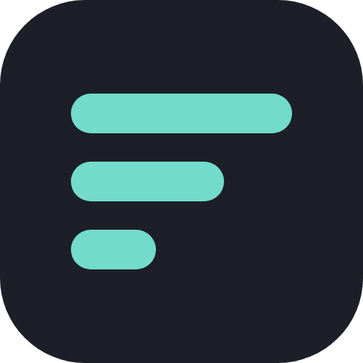

<!--markdownlint-disable-->

[](https://github.com/davelevine/tech-watch/actions/workflows/build.yml)
[](https://tech.levine.io)
[](https://tech.levine.io/rss.xml)

<div align="center">



# Tech Watch

The week's tech news, minus the noise.

</div>

<div align="center">

| Pipeline | Site | AI | Automation |
|---|---|---|---|
| [](https://www.python.org/) [](https://github.com/kurtmckee/feedparser) | [](https://pages.cloudflare.com/) [](https://developer.mozilla.org/en-US/docs/Web/JavaScript) [](https://github.com/mozilla/readability) | [](https://ollama.com/) | [](https://github.com/features/actions) |

</div>

## Overview

Tech Watch is a set-it-and-forget-it news digest covering AI, security, architecture, software delivery and tech regulation. It reads a curated list of feeds, has an LLM keep only the stories worth your time, writes each one up in a sentence, and picks five weekly essentials with a line on why they matter. It's inspired by [watch.edebost.com](https://watch.edebost.com/).

There's no server and no database. A scheduled GitHub Actions job does the work and commits a small JSON file, and a single static page renders it:

- [`build.py`](build.py) fetches the feeds in [`feeds.opml`](feeds.opml), scores and summarizes new items with Ollama Cloud, removes duplicate coverage, and writes [`site/data.json`](site/data.json) and [`site/rss.xml`](site/rss.xml).
- [`site/index.html`](site/index.html) and [`site/app.js`](site/app.js) are the whole front end: no framework, no build step. [`site/_headers`](site/_headers) sets the Content-Security-Policy.
- [`functions/api/read.js`](functions/api/read.js) powers the reader, pulling an article's text on demand when you open it.

### What you get

- **A calm feed:** a handful of stories on a big day and none on a slow one, grouped by day, with category filters, search and infinite scroll.
- **This week's essentials:** five picks, each with a "why it matters" line.
- **A built-in reader:** articles open in a clean reading pane, Feedbin-style. When a site won't give up its text, you get the original page or a link instead.
- **Remembers where you were:** articles added since your last visit are marked New, and ones you've read are dimmed. This lives in your browser only.
- **Feels native on a phone:** swipe right to close the reader, and Chrome on Android can install it as an app.
- **Keyboard-first on a desktop:** a ⌘K / Ctrl+K search palette, plus `j`/`k` or arrow-key navigation.
- **Light and dark themes, an RSS feed, and a page that refreshes itself** when a new build lands.

## How it works

Every four hours the Build workflow runs `build.py`:

1. **Fetch:** reads every feed. A broken feed is skipped, never fatal.
2. **Filter:** keeps dated entries from the last few days that haven't been seen before, capped per feed.
3. **Score:** sends new items to Ollama Cloud (`deepseek-v4.1-flash`) in batches. Each gets a category, a 1-10 relevance score judged within its category, and a one-sentence summary.
4. **Keep the notable ones:** 8+ for AI and Security, 7+ for the quieter categories, with a daily safety cap for unusually big news days.
5. **Drop repeats:** the model flags a story that's already on the site from the past week (the same launch from another outlet, say). The code checks that claim, so one copy always survives.
6. **Pick the essentials:** once a day, the model chooses the week's five.
7. **Publish:** writes the data and RSS, remembers seen URLs in `state.json`, commits, and Cloudflare Pages deploys on the push.

Everything older than 90 days is pruned, so the data stays small. It also looks after itself: a feed that has failed for two weeks lands in a single "Dead feeds" issue, and a run where every LLM call fails exits with an error so GitHub emails you.

<details>
  <summary><strong>The reader, and what it does with your data</strong></summary>

Opening an article calls `/api/read`, a Cloudflare Pages Function that fetches the page and extracts it with Mozilla's [Readability](https://github.com/mozilla/readability), the same approach as Firefox's reader view.

- **Nothing is stored or cached.** Responses are `no-store`, and the text exists only for as long as you're reading it.
- **It isn't an open proxy.** Only URLs that are already on the site are fetched.
- **The page can't run anything from the source site.** Extracted HTML is stripped of scripts, frames, styles and event handlers on the server. It's then rendered in a sandboxed frame with no access to the page; the only script allowed in there is the site's own swipe and keyboard relay, admitted by a per-render nonce.
- **A strict Content-Security-Policy backs all of this up.** Scripts load only from the site itself, plus two inline scripts allowed by exact hash; no plugins, forms or base-URL changes; network requests go only to the site. A test keeps the hashes in step with the code.
- **No login, no tracking.** Read and New markers live in your browser's local storage and never leave it.

</details>

## Keyboard shortcuts

| Keys | Action |
| ---- | ------ |
| <kbd>⌘</kbd> <kbd>K</kbd> / <kbd>Ctrl</kbd> <kbd>K</kbd> | Search palette: type, <kbd>↑</kbd>/<kbd>↓</kbd> to choose, <kbd>Enter</kbd> to read |
| <kbd>j</kbd> / <kbd>→</kbd> | Next article (switches articles inside the reader too) |
| <kbd>k</kbd> / <kbd>←</kbd> | Previous article |
| <kbd>Enter</kbd> | Open the focused article |
| <kbd>/</kbd> | Jump to the search bar |
| <kbd>Esc</kbd> | Close the palette or the reader |

On a phone, swipe right to close the reader; the feed slides back in underneath. Click an article's headline in the reader to open the original.

## Quick Start

Run the pipeline locally (it writes real data, so don't commit a local run's output unless you mean to):

```bash
python3 -m venv .venv && .venv/bin/pip install -r requirements.txt pytest
.venv/bin/pytest -q
OLLAMA_API_KEY=... .venv/bin/python build.py
```

Then serve the site. The reader needs the Pages runtime, so use Wrangler rather than a plain static server:

```bash
npm ci
node --test 'tests/*.test.js'
npx wrangler pages dev site
```

<details>
  <summary><strong>Running the browser smoke test</strong></summary>

With `npx wrangler pages dev site` running (it serves on port 8788 by default):

```bash
.venv/bin/pip install playwright && .venv/bin/python -m playwright install chromium
SMOKE_URL=http://127.0.0.1:8788 .venv/bin/pytest -q tests/test_smoke.py
```

If you change the theme script in `index.html` or the relay script in `app.js`, `node --test` prints the new hash to put in `site/_headers`.

</details>

<details>
  <summary><strong>Adding or removing feeds</strong></summary>

Edit [`feeds.opml`](feeds.opml); each feed is one `<outline>` line, and its `text` attribute is the publisher name shown on the site. Some big publishers (Anthropic, Cohere, Reuters) don't publish RSS. Anthropic comes from a community-maintained feed, and the Hacker News 300+ feed catches most of the rest.

</details>

<details>
  <summary><strong>Filling in history</strong></summary>

Run the Build workflow by hand with `backfill_days` set (say, 30). It looks back that far once, taking more entries per feed than a normal run. Everything already seen is skipped, so it's safe to rerun. Feeds only list their latest posts, though, so a backfill can only reach as far back as each feed still goes.

</details>

## CI/CD

| Workflow | Function | PR | Manual | Scheduled | Details |
| -------- | -------- | :-: | :----: | :-------: | ------- |
| [Build](./.github/workflows/build.yml) | Fetch, score, publish | ✓ | ✓ | ✓ | Every 4 hours at :17 UTC. On PRs it runs the Python and JavaScript tests only. Manual runs take an optional `backfill_days`. |
| [Build › smoke](./.github/workflows/build.yml) | Browser smoke test | ✓ | | | Loads the site in Chromium under its real CSP and checks the feed, reader, search palette and swipe-back. Fails on any CSP violation, console error or page error. |

[Renovate](https://docs.renovatebot.com/) ([`renovate.json`](renovate.json)) keeps every pin current: the GitHub Actions (pinned to commit digests), `feedparser`, Readability and linkedom, and the Playwright and Wrangler versions in the smoke job. New releases wait three days before an update is proposed. Patch and digest updates merge themselves once CI passes, including the browser smoke test; minor and major updates wait for review.

Cloudflare Pages deploys every push to `main`, including the bot's data commits, and builds a preview for every PR. Its build command is `npm ci` with `site` as the output directory. The only secret is `OLLAMA_API_KEY`, in the repo's Actions secrets.

## Configuration

The knobs live at the top of [`build.py`](build.py):

| Setting | Default | What it does |
| ------- | ------- | ------------ |
| `MIN_RELEVANCE` | 8 for AI/Security, 7 for the rest | Score a story needs to be kept |
| `DAILY_MAX` | 10 | Safety cap for unusually big news days |
| `DEDUPE_DAYS` | 7 | How far back to look for repeat coverage |
| `FRESH_DAYS` | 3 | Ignore feed entries older than this (env-overridable) |
| `PER_FEED` | 10 | Newest entries taken per feed per run (env-overridable) |
| `KEEP_DAYS` | 90 | Prune articles and seen URLs older than this |
| `DEAD_AFTER_DAYS` | 14 | Days of failures before a feed is reported |
| `OLLAMA_MODEL` | `deepseek-v4.1-flash` | Model used for scoring and summaries (env) |

How often it runs is the `cron` line in [`build.yml`](.github/workflows/build.yml).

## Credits

- [watch.edebost.com](https://watch.edebost.com/) — the inspiration, design language and palette
- [Mozilla Readability](https://github.com/mozilla/readability) and [linkedom](https://github.com/WebReflection/linkedom) — article extraction
- [feedparser](https://github.com/kurtmckee/feedparser) — making sense of every feed format there is
